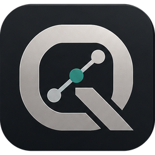

<p align="center">
  
</p>

<h1 align="center">RBG - QATRIVO</h1>

<p align="center">
  <strong>One workspace for test management, traceability, quality and reporting.</strong><br />
  Plan tests, capture execution evidence, track anomalies and review coverage — without scattering your data across separate tools.
</p>

<p align="center">
  <a href="https://github.com/Ruba94-cyber/RBG-QATRIVO/releases/latest"><strong>Download for Windows</strong></a> ·
  <a href="GUIDE.md">English guide</a> ·
  <a href="GUIDA.md">Guida italiana</a> ·
  <a href="https://github.com/Ruba94-cyber/RBG-QATRIVO/issues">Issues & feedback</a> ·
  <a href="#support-the-project">Donate</a>
</p>

<p align="center">
  
  
  
  
</p>

> [!IMPORTANT]
> **Public preview:** QATRIVO is a general-purpose edition generated from a more specialized application used by its author and team. It has automated tests and initial real-application UI checks, but this public edition has not yet undergone the same amount of field use. Keep backups, especially when working with important data.

## What is QATRIVO?

**RBG - QATRIVO** is a Windows desktop application for organizing testing and quality workflows from initial requirements through execution, nonconformities, audit and reporting.

It is designed for teams working in **software QA, hardware engineering, manufacturing quality and research laboratories** — as well as anyone who needs a structured, traceable testing process.

Typical workflow:

1. **Plan:** create products, components, requirements and reusable test cases.
2. **Execute:** document test steps, results, instruments, evidence and history.
3. **Investigate:** classify anomalies and change requests and connect them to the relevant tests.
4. **Review:** inspect dashboards, audit information and coverage matrices.
5. **Report:** export the information you need to Excel.

## Key features

| Area | Capabilities |
| --- | --- |
| **Requirements & test cases** | Ordered test steps, templates, results by product/component and configurable instrument/tool fields. |
| **Test execution** | Results recorded by operation, keyboard-friendly editing, evidence and execution history. |
| **Anomalies & change requests** | Classification, links to tests and a recovery bin. |
| **Audit & coverage** | Coverage matrices, audit views, dashboards and charts. |
| **Reporting** | Interactive Excel exports for lists, matrices and reports. |
| **Master data** | Products, product families, components, functions and spreadsheet import. |
| **Team workspaces** | Several PCs can work against a shared data folder with coordinated writes. |
| **Backup & archive** | Local workspace storage with backup and archival functions. |
| **Localization** | English, Italian and French interface. |

### Collaboration without a dedicated application server

QATRIVO stores the workspace in a folder you choose:

- **Individual use:** select a local data folder.
- **Team use:** point each PC at the same network share, or use a folder managed by a synchronization client.
- **Consistency:** locks and journals coordinate writers; synchronization conflict copies can be reconciled.
- **Responsiveness:** each PC keeps a rebuildable local SQLite index while the shared files remain the authoritative data.

**Good practice:** use the same QATRIVO version on each PC, keep regular backups, and allow access only to trusted collaborators. File synchronization can still introduce delays; shared-folder access is governed by the operating system and any sync service you use.

## Download & installation

**[Get the latest Windows release](https://github.com/Ruba94-cyber/RBG-QATRIVO/releases/latest)**

1. Download `RBG-QATRIVO-<version>-win-x64.zip` from **Releases**.
2. Extract the ZIP to a folder of your choice.
3. Open **`RBG - QATRIVO.exe`**. The published build is self-contained: no separate .NET runtime or installation wizard is required.
4. At first launch, choose the folder where your workspace data will live.
5. With an empty folder, you can select a **starter template** for software QA, hardware engineering, manufacturing quality or research, or begin with a blank workspace.

See the full **[user guide](GUIDE.md)** / **[guida utente](GUIDA.md)** for configuration, everyday workflows and troubleshooting.

### Signing & download safety

Release packages include SHA-256 checksums and a signed application. The signing certificate is **self-signed**, so Windows may still display an unknown-publisher or SmartScreen warning.

**Do not trust a downloaded executable without checking it.** Follow **[SIGNING.md](SIGNING.md)** to compare the certificate fingerprint and verify file integrity before deciding whether to import/trust the certificate.

## Build from source

Requirements: **.NET 10 SDK**. Windows is the tested desktop platform.

```sh
dotnet build TestLoom.slnx -c Release
dotnet run --project src/TestLoom.App/TestLoom.App.csproj -c Release
```

To use an isolated configuration folder (for example during testing):

```sh
dotnet run --project src/TestLoom.App/TestLoom.App.csproj -c Release -- --config <folder>
```

### Test suites

```sh
dotnet test src/TestLoom.App.Tests/TestLoom.App.Tests.csproj -c Release
dotnet test src/TestLoom.App.Tests.Headless/TestLoom.App.Tests.Headless.csproj -c Release
dotnet test src/TestLoom.App.UITests/TestLoom.App.UITests.csproj -c Release
```

The **FlaUI** suite drives the actual application through Windows UI Automation. It requires a Windows desktop session and a built executable. The presence of these tests does not imply full production validation of all workflows.

<details>
<summary><strong>Repository structure</strong></summary>

| Path | Purpose |
| --- | --- |
| `src/TestLoom.App/` | Avalonia desktop application |
| `src/TestLoom.App.MultiPcHost/` | Multi-PC/shared-folder test helper |
| `src/TestLoom.App.Tests/` | Application tests |
| `src/TestLoom.App.Tests.Headless/` | Headless tests |
| `src/TestLoom.App.UITests/` | Windows UI Automation tests |
| `TestLoom.slnx` | .NET solution |

</details>

## How this edition is maintained

QATRIVO is produced from a more specialized application through an **automatic, repeatable generation process**. Company-specific words are replaced with neutral terminology so this public edition can serve different kinds of teams while following improvements to the original application.

Some optional workflows retain the structure of the original system, such as an external ticketing-system integration. That integration is inactive unless configured.

Because application code is generated, **manual source changes in this repository can be overwritten**. Please read **[CONTRIBUTING.md](CONTRIBUTING.md)** before suggesting code changes. Bug reports, clear reproduction steps and feature ideas are welcome.

## Privacy, security & support

QATRIVO does not collect telemetry. Workspace files, a local index, evidence and history remain in the storage locations you choose. If you place the workspace on a network share or use third-party synchronization, the applicable permissions and service policies govern access to those files.

- **Questions, bugs and feature ideas:** [GitHub Issues](https://github.com/Ruba94-cyber/RBG-QATRIVO/issues). Share the application version and steps to reproduce, but use **synthetic data only**.
- **Security vulnerabilities:** follow [SECURITY.md](SECURITY.md) for private reporting; do not publish confidential information.
- **Guide:** [English](GUIDE.md) · [Italiano](GUIDA.md).

## Support the project

QATRIVO is developed and maintained independently. If it helps your work and you would like to support continued development, testing, documentation and improvements, **voluntary donations are appreciated**.

**[❤️ Support RBG - QATRIVO with PayPal](https://www.paypal.com/donate?business=paolo.ruba.1913%40gmail.com&no_recurring=0&item_name=Support+RBG-QATRIVO&currency_code=EUR)**

Donations are optional and do not change the software license or provide commercial usage rights beyond its terms.

## License & attribution

RBG - QATRIVO is **source-available under [PolyForm Shield License 1.0.0](LICENSE)**. The license permits certain uses, modifications and redistribution, including internal use, but restricts use to provide a competing product. **The full [LICENSE](LICENSE) is authoritative**; this summary is not legal advice.

Retain the [LICENSE](LICENSE) and [NOTICE](NOTICE) (including its Required Notice) when sharing copies. The name and application icon are not licensed for use as the branding of another product.

For commercial licensing or attribution questions, contact **paolo.ruba.1913@gmail.com**. Third-party components are documented in [THIRD-PARTY-NOTICES.md](THIRD-PARTY-NOTICES.md).

---

<p align="center"><sub>Made by Paolo Rubagotti · <a href="https://github.com/Ruba94-cyber/RBG-QATRIVO/releases/latest">Download</a> · <a href="https://github.com/Ruba94-cyber/RBG-QATRIVO/issues">Feedback</a> · <a href="#support-the-project">Support development</a></sub></p>
